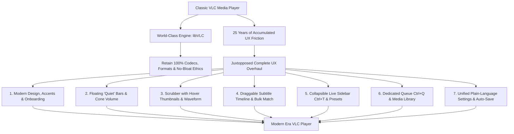
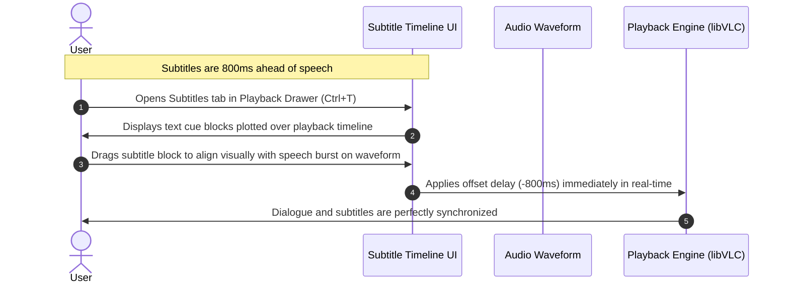

# Analysis: "I Redesigned VLC After 25 Years" (by Juxtopposed)

> **Video Title:** [I Redesigned VLC After 25 Years](https://www.youtube.com/watch?v=ERFeOgqk324)  
> **Creator:** [Juxtopposed](https://www.youtube.com/@juxtopposed)  
> **Release Date:** October 12, 2026  
> **Design License:** Creative Commons Attribution 4.0 (CC BY 4.0) via [Figma Community](https://www.figma.com/community/file/1691465999134370980/vlc-redesign)  
> **Target Software:** [VLC Media Player (VideoLAN)](https://www.videolan.org/vlc/)

---

## Executive Summary

For 25 years, VLC Media Player has remained the undisputed king of desktop media playback due to its ability to play virtually any format on any operating system without external codecs. However, its user interface has remained largely utilitarian—characterized by redundant menu bars, opaque modal dialog boxes that block the video while adjusting settings, confusing playlist-versus-queue mechanics, and an intimidating "Simple vs. All" preferences tree.

In this comprehensive redesign concept—created after consulting VLC's original creator and surveying community pain points—**Juxtopposed** overhauls VLC's entire user experience from the ground up. The design philosophy centers on **"Preserving the Power, Eliminating the Friction"**: modernizing the visual identity and ergonomics while surfacing the power-user features that make VLC iconic.



---

## 1. Visual Identity, Theming & Onboarding

### First-Run Onboarding Experience
* **Interactive Setup Wizard:** Instead of dropping new users straight into an empty grey window with a lone traffic cone, a clean onboarding flow welcomes users upon first launch to configure:
  1. Default Application Language (multi-language support).
  2. Primary Media Folder scan locations.
  3. Theme mode (Light, Dark, AMOLED Black, System).
  4. Custom accent color palette.
  5. Interactive cheat-sheet introducing core playback shortcuts.

### Theme Engine & Accent Colors
* **Adaptive Theme Palette:** Replaces the dated default OS-framed chrome with a cohesive, modern dark mode (default), AMOLED pitch-black (for OLED screens), crisp light mode, and automatic system theme syncing.
* **Customizable Accent Palette:** Retains VLC's signature Traffic Cone Orange as the primary brand accent, while offering **9+ selectable accent color swatches** (including Neon, Sunset, Aurora, and Synthwave). The chosen accent dynamically styles the Play pill button, seek bar progress, volume fills, and active toggles.

### Typography & Iconography
* **Modern Typeface:** Adopts the high-legibility **Inter** typeface across all menus, timestamps, and metadata views to establish a clear optical hierarchy.
* **Refined Iconography & Cone Motif:** Replaces legacy heterogeneous icons with unified, minimal vector icons and updates the classic striped traffic cone into a sleeker geometric emblem with an embedded play triangle.

---

## 2. Player Interface & Control Bar Overhaul

### Floating "Quiet" Controls (Auto-Hiding HUD)
* **Unobtrusive Playback Canvas:** Both the top header bar and bottom playback bar float translucently over the video canvas. They appear smoothly on mouse movement and fade out completely when the cursor stops—both in windowed and fullscreen modes.
* **Pinnable Controls Option:** For users who prefer traditional static toolbars outside fullscreen, a single toggle in Preferences keeps the top and bottom bars permanently visible without overlapping the video frame.
* **Adaptive Window Resizing:** When loading a video, the window automatically scales to match the video's aspect ratio and resolution (capped at 70% of the display) to eliminate black bars on launch.

### Consolidated Top Bar
* **Elimination of the Redundant Menu Bar:** Removes the legacy 8-item top text menu (`Media`, `Playback`, `Audio`, `Video`, `Subtitle`, `Tools`, `View`, `Help`) that duplicated right-click context menus.
* **Single Unified Menu Button:** Consolidates global app actions into one clean dropdown menu on the top left.
* **In-Player Breadcrumb / Library Toggle:** Displays the active folder or media title in the top bar; clicking the folder name opens the Media Library view without stopping playback.
* **Quick View Modes (Top Right):** Dedicated one-click buttons for Mini Player / Picture-in-Picture (PiP), Casting, and Fullscreen.

```
+---------------------------------------------------------------------------------------+
| [Cone] [Menu v]  Severance ▸ S01E04 - The You You Are         [Cast] [PiP] [_] [口] [X] |
|---------------------------------------------------------------------------------------|
|                                                                                       |
|                                     VIDEO VIEWPORT                                    |
|                              (100% Unobstructed Playback)                             |
|                                                                                       |
| [ 24:15 ] ====================|================================ [ 55:20 ] ( -31:05 )  |
|                                                                                       |
| [ |< ]  [ < 10s ]  [   PLAY / PAUSE   ]  [ 10s > ]  [ >| ]  [ 1.0x ]                  |
| [Cone Vol: 85% /====]       [Subs]  [Audio]  [Queue (4)]  [Bookmarks]  [Settings]     |
+---------------------------------------------------------------------------------------+
```

### Reorganized Bottom Control Bar
* **Prominent Play/Pause Button:** Styled as a solid rounded pill in the user's chosen accent color, flanked by Previous/Next buttons and 10-second skip buttons.
* **Horizontal Traffic-Cone Volume Control:** Reimagines VLC's iconic vertical triangle volume meter as a playful horizontal cone-shaped slider next to the playback controls. Supports clicking, dragging, and mouse-wheel scrolling up to **125%–200% volume boost** with visual amplification feedback.
* **Right-Side Utility Cluster:** Moves track and view management to the bottom-right corner with dedicated, single-click popup/sidebar toggles for:
  - Subtitles track & styling.
  - Audio tracks & output hardware switcher.
  - Active Queue flyout.
  - Bookmarks & Chapter navigation.
  - Quick Settings drawer.

---

## 3. Enhanced Seek Bar & Timeline Upgrades

* **Thick, Ergonomic Scrubber:** Replaces the thin, hard-to-hit progress line with a thick, responsive seek bar spanning the full width of the player.
* **Hover Frame Previews:** Hovering anywhere along the timeline displays a cached video thumbnail preview and exact timestamp before clicking to seek.
* **Chapter & Bookmark Ticks:** Embeds visual tick marks and chapter segments directly into the seek bar, displaying chapter titles on hover.
* **Instant Millisecond Bookmarking (`Ctrl+B`):** Pressing `Ctrl+B` immediately drops a bookmark at the exact millisecond (`HH:MM:SS.mmm`) on the timeline without an interruptive naming dialog.
* **Continuous Audio Waveform:** An optional audio waveform overlay rendered as a continuous ribbon across the seek bar, colored in the user's accent for played audio and neutral tone for unplayed audio.
* **Reverse Playback Controls:** Dedicated reverse frame-stepping (`,` / `.`) and smooth reverse playback options.

---

## 4. Non-Intrusive Settings Sidebar (No More Modal Dialogs)

* **Goodbye to Video-Blocking Popups:** In legacy VLC, opening *Effects and Filters* (`Ctrl+E`) or *Preferences* (`Ctrl+P`) spawns a large, opaque dialog box right on top of the video, making it impossible to see how adjustments actually affect the picture.
* **Collapsible Right-Hand Sidebar (`Ctrl+T`):** All playback, audio, video, and subtitle adjustments slide out in a clean docked sidebar panel beside or floating at the edge of the video.
* **Tabbed Organization:** Divided into logical tabs—**Subtitles, Audio, Video, Playback, and Bookmarks**—allowing real-time visual feedback while the video continues playing uninterrupted.

---

## 5. Revolutionary Subtitle Management



* **Visual Drag-to-Sync Subtitle Timeline:**
  - Instead of blindly guessing positive or negative millisecond offsets with hotkeys (`G` / `H`), users can open a visual subtitle timeline around the current playhead.
  - Displays upcoming and past subtitle cue blocks alongside audio waveforms so users can click and drag subtitle lines directly into sync with speech.
  - Retains fine-grained millisecond delay sliders and subtitle speed multipliers.
* **Live Appearance Customization:**
  - Instant visual controls for Font Family (any system font or custom `.ttf`/`.otf`), Size (relative scale or exact pixel size), Text Color, Outline Thickness/Color, Background Box Opacity, and Vertical Position.
* **Bulk Season/Folder Subtitle Matching:**
  - Allows adding external subtitle files (`.srt`, `.ass`, `.vtt`) in bulk to an entire folder, season, or queue at once.
  - Automatically pairs subtitle files to video files by parsing episode numbers (e.g., `S01E02`, `1x02`, `EP02`), allows manual pairing adjustments, and remembers rules for upcoming files.
* **Native OpenSubtitles Search:**
  - Replaces the clunky VLSub extension popup with a built-in "Search Online" workflow to query and download subtitle tracks directly inside the player window.

---

## 6. Audio, Video & Per-Show Presets

### Video Adjustments & Filters
* **Categorized Filter Groups:** Reorganizes VLC's overwhelming wall of technical checkboxes into clean, collapsible groups: **Essential, Colors, Crop, Geometry, Overlay (watermarks), and Advanced**.
* **One-Click Visual Presets:** Introduces quick-select picture mode cards (**Vivid, Bright, Cinema, Soft, Mono**) alongside granular sliders for Brightness, Contrast, Gamma, Saturation, Hue, Sharpen, Film Grain, and Sepia.
* **Interactive Geometry Controls:** Streamlined buttons and sliders for Rotate ($90^\circ$, $180^\circ$, $270^\circ$, or custom angle), Flip/Mirror (horizontal/vertical), Aspect Ratio, Crop, and Interactive Zoom.

### Audio Controls & Equalizer
* **Direct Audio Output Device Switcher:** Clicking the Audio button in the bottom bar lets users switch output hardware (e.g., Laptop Speakers vs. Bluetooth Headphones) in two clicks without opening system settings.
* **Modern 10-Band Equalizer:** Features a clean graphical curve, one-click genre preset chips (**Flat, Rock, Pop, Club, Full Bass, Headphones, Vocal**), Dynamic Range Compressor, Reverb / Spatial Audio, Stereo Widener, and audio-video synchronization delay sliders.

### Per-Show / Per-Folder Saved Presets
* **Automatic Show Rules:** Users can save their customized subtitle delay, subtitle styling, preferred audio/subtitle language pairing (e.g., Japanese audio + English subtitles), playback speed, and video filters as a **Preset tied to a specific folder or series**. Every subsequent episode opened from that folder applies those exact settings automatically.

---

## 7. Queue vs. Playlist Separation & Media Library

### Fixing the "Playlist" Confusion
* **Dedicated Active Queue (`Ctrl+Q`):** Legacy VLC conflated the temporary "Now Playing" list with saved playlists. The redesign introduces a dedicated **Floating Queue Panel** where users can drag and drop files from their file manager, reorder upcoming tracks, bulk-remove items, or mark episodes as watched.
* **Smart Auto-Queueing:** Opening a single episode from a folder automatically queues the remaining episodes in sequential order so the next episode plays seamlessly.
* **Distinct Saved Playlists:** Separates permanent, named playlists from the temporary playback queue, complete with playlist search, cover artwork, export, and watch-count tracking (e.g., *"12 items · 5 watched"*).

### Built-In Media Library & Home View
* **"Continue Watching" Dashboard:** A modern Home view displays recently played videos with visual progress bars, exact timestamps (e.g., *"Continue from 24:15"*), and a one-click button to mark items as watched.
* **Smart Title Parsing:** Automatically cleans up messy file names on the Home and Library cards:
  $$\text{Severance.S01E04.1080p.WEB-DL.x265.mkv} \longrightarrow \mathbf{Severance} \text{ (S01E04)}$$
* **Breadcrumb Folder Browser:** Full-featured local directory navigation with Back, Forward, Up, address bar, search bar, pinned folders, and sorting (including *Unwatched First*).
* **Dedicated Music Library with Synchronized Lyrics:**
  - Automatically indexes audio folders by Artist, Album, and Song with embedded album cover art.
  - Integrated `.lrc` lyric support: synchronized lyrics scroll smoothly in real time, and clicking any lyric line immediately jumps playback to that exact verse (`Y` key toggles between album art view and lyrics view).
* **Streamlined Network Streams:** Simplifies opening network streams (`http`, `rtsp`, `mms`) and `.m3u` IPTV channel lists by turning pasted links or playlists into an interactive channel queue.

---

## 8. Overhauled Preferences & Keyboard Shortcuts

### Killing the "Simple vs. All" Labyrinth
* **13 Clean, Human-Readable Categories:** Replaces VLC's infamous two-tier Preferences window (where half the settings were hidden inside an intimidating technical tree) with a unified, modern Settings Window divided into 13 logical categories:
  1. *General* (Language, Onboarding, Theme, Accent Color)
  2. *Interface* (Quiet Bars, Pin Controls, Rounded Corners)
  3. *Playback* (Resume point, Auto-queue, History)
  4. *Audio* (Default output, Equalizer, Boost cap)
  5. *Video* (Hardware acceleration, Default deinterlacing)
  6. *Subtitles* (Default language, Fuzzy matching rules, Fonts)
  7. *Controls & Hotkeys* (Visual key mapper, Conflict detection)
  8. *Library* (Monitored folders, Metadata scraping)
  9. *Network & Streams* (Buffer sizes, Proxy, IPTV)
  10. *Privacy* (Crash reporting, Metadata lookups, Clearing history)
  11. *Performance* (Hardware decoding, Thread counts, Post-processing)
  12. *Extensions & Add-ons* (Plugin catalog, Skin manager)
  13. *Advanced / Developer* (Raw configuration registry with search)
* **Hover Tooltips `(i)`:** Explains technical terms (hardware decoding modes like DXVA2, NVDEC, VA-API, buffers) in plain English.
* **Instant Auto-Save:** Eliminates the frustration of forgetting to click the bottom-right "Save" button and having to restart VLC for basic changes to take effect.

### Visual Shortcut HUD & Remapper
* **On-Screen Display (OSD) Pills:** Pressing keyboard shortcuts triggers subtle, modern on-screen HUD pills confirming the action and parameter value.
* **Searchable Keyboard Shortcut Mapper (`F1`):** Graphical hotkey manager with real-time key listening, conflict detection, and one-click reset to defaults.

---

## Summary Comparison: Legacy VLC vs. Juxtopposed Redesign

| Feature Area | Legacy VLC (3.x) | Juxtopposed Redesign |
| :--- | :--- | :--- |
| **Control Bars** | Static grey/system toolbars; separate fullscreen floating controller. | Unified translucent "quiet" bars that auto-hide on idle (or pin optionally). |
| **Volume Control** | Vertical triangle widget capped at $125\%$. | Horizontal traffic-cone slider with scroll-wheel support & boost to $200\%$. |
| **Settings & Filters** | Opaque modal dialogs (`Ctrl+E` / `Ctrl+P`) that cover the video. | Collapsible right-hand sidebar (`Ctrl+T`) with live video preview. |
| **Subtitle Syncing** | Blind millisecond offset boxes / `G` & `H` hotkeys. | Visual Drag-to-Sync Subtitle Timeline plotted against speech waveform. |
| **Bulk Subtitles** | Must load external `.srt` files one video at a time. | Bulk folder/season matching by episode code (`S01E02`) + native OpenSubtitles. |
| **Queue vs. Playlist** | Combined into a single confusing "Playlist" window (`Ctrl+L`). | Separate Active Queue sidebar (with auto-folder queueing) & Saved Playlists. |
| **Home / Library** | Blank cone screen on launch; rudimentary playlist tree. | Continue Watching dashboard, smart file-name cleanup, & Music/Folder library. |
| **Music Experience** | Basic playlist entry; no lyrics or ambient views. | High-res cover art, ambient background, and interactive scrolling `.lrc` lyrics. |
| **Preferences** | Divided into "Simple" and a complex "All" technical tree; requires manual Save. | Unified, searchable, plain-language categories with tooltips & instant auto-save. |
| **Onboarding** | No first-run wizard; opens directly to empty canvas. | Interactive wizard configuring language, theme, accent color, and folders. |

---

## Community Working Implementations

Because Juxtopposed released the complete Figma design file under a CC BY 4.0 open license, several developers in the open-source community turned the concept video into real, downloadable software across Windows, macOS, and Linux:

1. **`dsojevic/juxtopposed-vlc` (Native VLC Fork):**  
   A direct C++/QML fork of the official VideoLAN repository adapting Juxtopposed's interface natively into VLC (complete with seekbar thumbnail caching, subtitle cue timelines, filter groups, and library sidebars).
2. **`nirmaljosephukken/pylon-player` (Pylon):**  
   A lightweight Python/PySide6 media player built directly on top of `libVLC` featuring the quiet hover bars, cone volume slider, visual drag-to-sync subtitle timeline, and per-show presets.
3. **`stanotermans/vlcmediaplayerv2` (VLC Redesign Desktop App):**  
   A cross-platform desktop implementation featuring the full onboarding flow, 9 accent colors, light/dark modes, 10-band equalizer, `.lrc` lyric synchronization, and FFmpeg-backed playback.
4. **`TheRealChickon/vlc-redesign` (VLC 4.0 Native Release):**  
   A native Windows/Linux build addressing all 18 review findings from the video audit, including full settings registry integration, millisecond bookmarks, dual folder/queue panels, and draggable seek-bar cue timing.

---

*Document compiled from Juxtopposed's original video walkthrough, Figma Community design specifications, and community open-source validation audits.*
